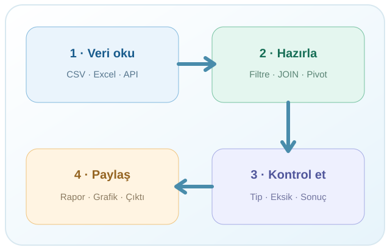

::: {.training-hero}
::: {.hero-copy}
AÇIK • UYGULAMALI • TEKRAR KULLANILABİLİR

# Veriden içgörüye, adım adım.

**R ile düşünmeyi, veriyi hazırlamayı ve sonuçları kontrol etmeyi öğrenin.** İlk komuttan güvenilir bir analiz tablosuna uzanan uygulamalı bir öğrenme yolu.

[**Öğrenmeye başla**](lessons/01-r-ve-rstudio.qmd){.btn .btn-primary .btn-lg} [Eğitim materyallerini incele](materials/index.qmd){.btn .btn-outline-secondary .btn-lg}

:::
::: {.hero-art}
{fig-alt="Veri okuma, hazırlama ve kontrol etme adımlarını gösteren öğretici akış"}
:::
:::

## Öğrenme yolu

Bu site tarihten, kurumdan ve eğitim süresinden bağımsız bir **uygulama kütüphanesidir**. Konuları sırayla izleyebilir veya ihtiyaç duyduğunuz uygulamaya doğrudan gidebilirsiniz.

::: {.grid}
::: {.g-col-12 .g-col-md-6 .g-col-xl-3}
::: {.path-card}
01
### Ortamı tanı
R, RStudio, ilk komutlar, veri tipleri ve paketler.

[Başlangıç dersleri](lessons/01-r-ve-rstudio.qmd)
:::
:::
::: {.g-col-12 .g-col-md-6 .g-col-xl-3}
::: {.path-card}
02
### Programla
Koşullar, döngüler, fonksiyonlar ve okunabilir kod.

[Koşullu ifadeler](lessons/05-kosullu-ifadeler.qmd)
:::
:::
::: {.g-col-12 .g-col-md-6 .g-col-xl-3}
::: {.path-card}
03
### Veriyi hazırla
Dosya aktarımı, `dplyr`, JOIN ve pivot uygulamaları.

[Veri hazırlama](lessons/10-dplyr-temelleri.qmd)
:::
:::
::: {.g-col-12 .g-col-md-6 .g-col-xl-3}
::: {.path-card}
04
### Uygula & doğrula
WDI verileriyle uçtan uca bir veri işleme görevi.

[Mini proje](lessons/15-uctan-uca-mini-proje.qmd)
:::
:::
:::

## Bu kaynağı nasıl kullanabilirsiniz?

::: {.grid}
::: {.g-col-12 .g-col-md-4}
::: {.method-card}
### 1 · Önce anla
Konu sayfasında **neden ve ne zaman** sorusunu okuyun. Yeni kavramlar bilinenlerin üzerine kurulur.
:::
:::
::: {.g-col-12 .g-col-md-4}
::: {.method-card}
### 2 · RStudio'da dene
Kodu sayfadan kopyalayın ya da ilgili `.R` scriptini indirin. Satır satır çalıştırın, çıktıyı tahmin edin.
:::
:::
::: {.g-col-12 .g-col-md-4}
::: {.method-card}
### 3 · Kontrol et
Egzersizleri çözün; satır sayısı, veri tipi ve beklenen sonuçları doğrulayın. Yanlış sonuç da öğreticidir.
:::
:::
:::

## Eğitimde ve eğitimden sonra

**Eğitmen eşliğinde:** Konuların çekirdek uygulamaları seçilir; süre ve katılımcı düzeyine göre örnekler uyarlanır. [Örnek beş günlük program](program/index.qmd) bir uygulama biçimidir, sitenin kullanım sınırı değildir.

**Bağımsız öğrenmede:** Her dersin açıklamaları, scriptleri, alıştırmaları ve ileri okuma bağlantıları kullanılabilir. [Materyaller](materials/index.qmd) sayfasından dosyaları indirebilirsiniz.

::: {.resource-strip}
**Daha fazlasını öğrenin:** [R Programlama Kitabı](https://mfatihtuzen.github.io/r-programlama/) · [R İstatistik Akademi — YouTube](https://www.youtube.com/@RistatistikAkademi) · [Seçilmiş öğrenme kaynakları](resources/ogrenme-kaynaklari.qmd)
:::

[**İlk bölüme geç: R ve RStudio →**](lessons/01-r-ve-rstudio.qmd){.btn .btn-primary}

::: {.callout-note}
**Eğitmen ve içerik hakkında:** Bu eğitim materyalleri Muhammed Fatih Tüzen tarafından hazırlanmıştır. [Eğitmen hakkında](about.qmd) sayfasında mesleki çalışma alanlarını ve diğer açık kaynaklarını bulabilirsiniz.
:::
