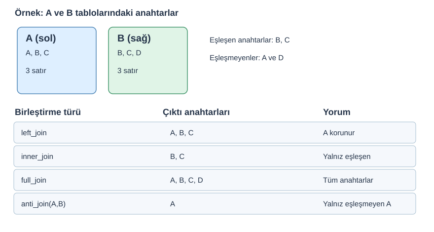

::: {.callout-note}
## Bu bölüm nasıl kullanılmalı?
Önce kısa açıklamayı okuyun; kodun sonucunu tahmin edin; ardından RStudio'da satır satır çalıştırın. **A** temel sınıf içeriği, **B** pekiştirme, **C** ise bağımsız çalışmadır. Tüm kodları aynı gün bitirmek zorunda değilsiniz.
:::

**Uygulama dosyası:** [R scriptini indir](../scripts/14-dplyr-join-ve-kontrol.R){download="14-dplyr-join-ve-kontrol.R"} · [Alıştırmaları indir](../exercises/13-dplyr-join.md){download="13-dplyr-join.md"} · [Tüm materyaller](../materials/index.qmd)

**Ön koşul:** RStudio Project ile çalışma, veri okuma ve temel nesne/veri yapıları. **Veri:** `data/wdi/` altındaki kitap kaynaklı WDI eğitim alt kümeleri. Dosya yolları proje köküne göredir.

## 1. Neden iki tabloyu birleştiriyoruz? (A)

Örneğin ülke–yıl göstergelerimiz bir tabloda, bölge ve gelir grubu metadata bilgilerimiz başka tabloda olabilir. JOIN, **iki tabloyu ortak anahtarlar üzerinden** ilişkilendirir. `bind_rows()` ise alt alta satır ekler; JOIN ile aynı işlem değildir.

**Gözlem birimi:** 2019 kesitinde her ülke tek satırdır. Panelde ise aynı ülke farklı yıllarda tekrar eder. **Anahtarın tekilliği bağlama göre değişir.**

## 2. JOIN şeması — küçük örnek (A)

{fig-alt="A ve B tablolarının anahtarları ve left, inner, full, anti join çıktıları."}

*Şema eğitim için özgün olarak hazırlanmıştır. Kavramsal kaynak: [R for Data Science 2e, Joins](https://r4ds.hadley.nz/joins.html) ve [dplyr join belgeleri](https://dplyr.tidyverse.org/reference/mutate-joins.html).*

```{.r}
library(dplyr)
a <- tibble(kod = c("A", "B", "C"), sayi = c(10, 20, 30))
b <- tibble(kod = c("B", "C", "D"), grup = c("X", "Y", "Z"))

left_join(a, b, by = "kod")
inner_join(a, b, by = "kod")
anti_join(a, b, by = "kod")
```

| Fonksiyon | Hangi satırlar kalır? | Kullanım örneği |
|---|---|---|
| `left_join(x,y)` | `x` tarafının tüm satırları | Ülke tablosuna bölge eklemek |
| `inner_join(x,y)` | İki tarafta da eşleşenler | Ortak kapsamı bulmak |
| `full_join(x,y)` | Her iki tablodaki satırlar | Kapsamları bir araya getirmek |
| `semi_join(x,y)` | `x` içinden eşleşenler; `y` sütunları gelmez | Kapsam filtrelemek |
| `anti_join(x,y)` | `x` içinden eşleşmeyenler | Eşleşme hatası kontrolü |

::: {.callout-warning}
## Yanlış JOIN sessiz bir veri hatası yaratabilir
Eşleşmeyen kayıtlar `inner_join()` ile düşebilir; birden fazla eşleşme ise satır sayısını büyütebilir. Kod hata vermese bile analiz bozulabilir. `relationship = "many-to-one"` gibi beklenti tanımları, yanlış ilişkiyi hata olarak yakalamaya yardımcı olur.
:::

## 3. WDI ile güvenli birleştirme (A)

```{.r}
wdi <- readr::read_csv("data/wdi/wdi_2019.csv", show_col_types = FALSE)
meta <- readr::read_csv("data/wdi/country_metadata.csv", show_col_types = FALSE)

# Metadata ülke kodu bakımından tekil mi?
anyDuplicated(meta$country_code)

sonuc <- wdi |>
  left_join(meta |> select(country_code, region, income_group),
            by = "country_code", relationship = "many-to-one")

stopifnot(nrow(sonuc) == nrow(wdi))

# Eşleşmeyenleri görün:
anti_join(wdi, meta, by = "country_code") |> select(country_code)
```

**Not:** `relationship` eşleşme çokluğunu denetler, eşleşmeyen satırların varlığını tek başına garanti etmez. `anti_join()` ayrıca gereklidir.

## 4. Ülke–yıl anahtarı ve çoktan-çoğa hata (A/B)

```{.r}
panel <- readr::read_csv("data/wdi/wdi_panel_2015_2022.csv", show_col_types = FALSE)

# Doğru eşsiz anahtar: country_code + year
stopifnot(!anyDuplicated(panel[c("country_code", "year")]))

# Sadece country_code ile paneli panelle birleştirmek yanlış!
# (aynı ülkenin birden fazla yılı birçok kez eşleşir)
```

Bu durumda `many-to-many` uyarısını sadece susturmak çözüm değildir. Önce hangi tablo düzeyinde çalışılması gerektiğini düşünün.

## 5. İleri örnekler (B/C)

- `join_by()` iki tablodaki farklı isimli alanları eşleyebilir.
- `right_join()` ve `full_join()` kapsama sorularında kullanışlıdır.
- `relationship`, `unmatched`, `na_matches` parametreleri belirli kontroller sunar.
- `bind_rows()` sütunları uyumlu tabloları alt alta getirir, anahtar eşleştirmesi yapmaz.

**Kaynaklar:** [dplyr JOIN ayrıntıları](https://dplyr.tidyverse.org/reference/mutate-joins.html) · [R for Data Science — Joins](https://r4ds.hadley.nz/joins.html).


## Öğrendiklerinizi kontrol edin

- Bu işlem hangi satırları veya sütunları değiştiriyor?
- Eksik değerler sonuçları nasıl etkiliyor?
- Beklenen gözlem sayısını nasıl doğrularım?

**Alıştırma:** [Bu bölümün görevleri](../exercises/13-dplyr-join.md){download="13-dplyr-join.md"}. **Ek okuma:** [R Programlama Kitabı](https://mfatihtuzen.github.io/r-programlama/) · [dplyr](https://dplyr.tidyverse.org/) · [tidyr](https://tidyr.tidyverse.org/).

---

[← Önceki konu](12-dplyr-gruplama.qmd) · [Sonraki konu →](14-tidyr-pivot.qmd)
