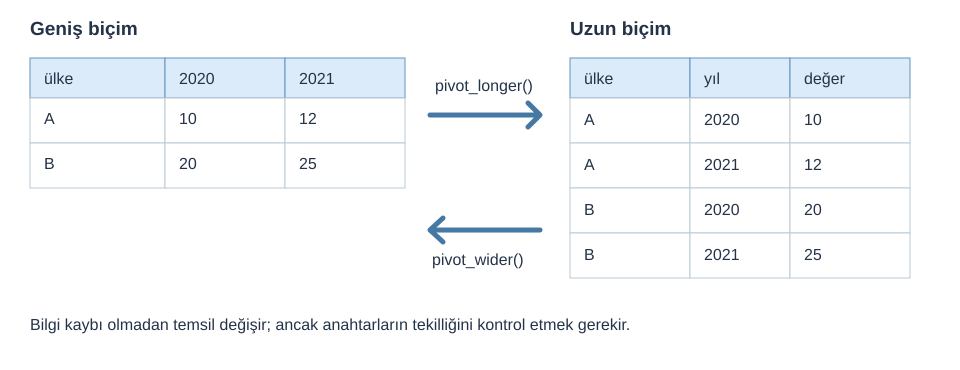

::: {.callout-note}
## Bu bölüm nasıl kullanılmalı?
Önce kısa açıklamayı okuyun; kodun sonucunu tahmin edin; ardından RStudio'da satır satır çalıştırın. **A** temel sınıf içeriği, **B** pekiştirme, **C** ise bağımsız çalışmadır. Tüm kodları aynı gün bitirmek zorunda değilsiniz.
:::

**Uygulama dosyası:** [R scriptini indir](../scripts/15-tidyr-pivot-ve-tidy-veri.R){download="15-tidyr-pivot-ve-tidy-veri.R"} · [Alıştırmaları indir](../exercises/14-tidyr-pivot.md){download="14-tidyr-pivot.md"} · [Tüm materyaller](../materials/index.qmd)

**Ön koşul:** RStudio Project ile çalışma, veri okuma ve temel nesne/veri yapıları. **Veri:** `data/wdi/` altındaki kitap kaynaklı WDI eğitim alt kümeleri. Dosya yolları proje köküne göredir.

## 1. Tidy veri: neden biçim değiştiriyoruz? (A)

Bir veri setinin **geniş** biçiminde yıllar veya göstergeler sütun olabilir. **Uzun** biçimde ise aynı bilgi, `yıl` / `gösterge` / `değer` sütunlarına yerleşir. İşlemin amacı satır ve sütun yerini değiştirmek değil, gözlem birimini ve amaçlanan analizi uygun temsil etmektir.

## 2. Özgün pivot şeması (A)

{fig-alt="A ve B ülkelerinin 2020-2021 değerleri geniş ve uzun biçimlerde gösterilmiştir."}

*Şema eğitim için özgün olarak hazırlanmıştır. Kavramsal kaynaklar: [tidyr pivot rehberi](https://tidyr.tidyverse.org/articles/pivot.html), [`pivot_longer`](https://tidyr.tidyverse.org/reference/pivot_longer.html), [`pivot_wider`](https://tidyr.tidyverse.org/reference/pivot_wider.html).*

```{.r}
library(dplyr)
library(tidyr)
genis <- tibble(country = c("A", "B"), `2020` = c(10, 20), `2021` = c(12, 25))
uzun <- genis |>
  pivot_longer(cols = c(`2020`, `2021`), names_to = "year", values_to = "value")
uzun

uzun |>
  pivot_wider(id_cols = country, names_from = year, values_from = value)
```

## 3. `names_to`, `values_to`, `names_from`, `values_from` (A)

| Fonksiyon | Argüman | Anlamı |
|---|---|---|
| `pivot_longer()` | `cols` | Uzun biçime taşınacak sütunlar |
| `pivot_longer()` | `names_to` | Kaynak sütun adlarının tutulacağı yeni sütun |
| `pivot_longer()` | `values_to` | Değerleri taşıyan yeni sütun |
| `pivot_wider()` | `names_from` | Yeni sütun adlarını üretecek değişken |
| `pivot_wider()` | `values_from` | Hücrelerde kullanılacak değer değişkeni |
| `pivot_wider()` | `id_cols` | Satırı tanımlayan gözlem anahtarı |

## 4. WDI panelini dönüştürme (A)

```{.r}
panel <- readr::read_csv("data/wdi/wdi_panel_2015_2022.csv", show_col_types = FALSE)

uzun_wdi <- panel |>
  select(country_code, year, unemployment_total_pct, internet_users_pct) |>
  pivot_longer(cols = c(unemployment_total_pct, internet_users_pct),
               names_to = "indicator", values_to = "value")

uzun_wdi |> head(8)
```

WDI eğitim paketinde `wdi_long_2015_2022.csv` da bulunmaktadır. Bu dosyada `indicator_label` ve `unit` sütunları tutulur; farklı birimlerdeki değerleri tek ortalamada birleştirmek anlamsızdır.

## 5. Tekrarlı anahtar ve eksik gözlemler (B)

- `pivot_wider()` için `id_cols + names_from` birleşimi çoğu uygulamada tekil olmalıdır.
- Tekrarlı anahtarlar list-sütun üretebilir. `values_fn = mean` ancak tekrarların nedenini biliyorsanız kullanılmalıdır; aksi hâlde veri kaybını gizleyebilir.
- `values_drop_na = TRUE` açık eksikleri örtük eksiklere çevirebilir. Varsayılan davranışı anlamadan kullanmayın.
- `names_transform = list(year = as.integer)` yıl adlarını dönüştürmek için kullanılabilir.

::: {.callout-tip}
## Uygulama
Ülke-yıl gözlemlerinde iki göstergeyi uzun biçime dönüştürün, sonra geri çevirin. Gözlem sayısı ve seçilen sayısal değerlerin korunduğunu kontrol edin.
:::

**Kaynaklar:** [tidyr pivot rehberi](https://tidyr.tidyverse.org/articles/pivot.html) · [R for Data Science — Data tidying](https://r4ds.hadley.nz/data-tidy.html).


## Öğrendiklerinizi kontrol edin

- Bu işlem hangi satırları veya sütunları değiştiriyor?
- Eksik değerler sonuçları nasıl etkiliyor?
- Beklenen gözlem sayısını nasıl doğrularım?

**Alıştırma:** [Bu bölümün görevleri](../exercises/14-tidyr-pivot.md){download="14-tidyr-pivot.md"}. **Ek okuma:** [R Programlama Kitabı](https://mfatihtuzen.github.io/r-programlama/) · [dplyr](https://dplyr.tidyverse.org/) · [tidyr](https://tidyr.tidyverse.org/).

---

[← Önceki konu](13-dplyr-join.qmd) · [Sonraki konu: Mini proje →](15-uctan-uca-mini-proje.qmd)
