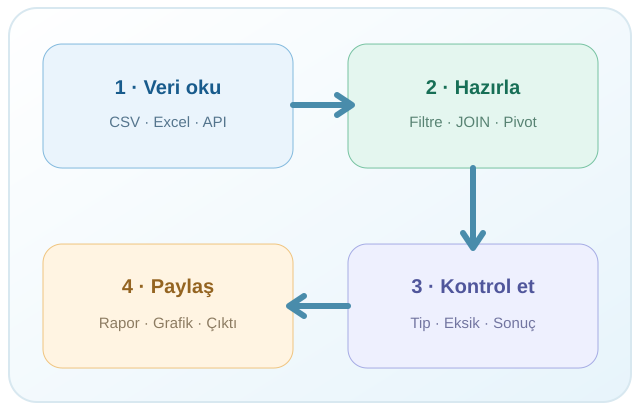

## Veriyi okumak başka, anlamak başka {.title-frame}

::: {.columns}
::: {.column width="62%"}
R PROGRAMLAMA • VERİ BİLİMİ • UYGULAMA

Veriyi okumak başka, anlamak başka.

**Soru sor → Kodla → Kontrol et → Paylaş**

[R Programlama Kitabı](https://mfatihtuzen.github.io/r-programlama/) · [Eğitim sitesi](https://mfatihtuzen.github.io/r-training/)
:::
::: {.column width="38%"}
{fig-alt="Veri analizinin dört temel adımı" width="100%"}
:::
:::

::: {.notes}
Açılışta katılımcıların veriyle çalışma deneyimini sor. Bu slayt kod anlatımı değil, eğitim hedefinin çerçevesidir.
:::

## Günlük bir işi düşünelim

::: {.columns}
::: {.column width="48%"}
::: {.slide-panel}

Her ay aynı iş...

- Dosyalar gelir.
- Değişken adları değişebilir.
- Eksikler ve tutarsızlıklar çıkar.
- Aynı hesap tekrar yapılır.
:::
:::
::: {.column width="48%"}
::: {.slide-panel .accent-panel}

Kodla kurulan iş akışı

- Adımları kaydet.
- Sonucu kontrol et.
- Hataları düzelt.
- Bir sonraki ay yeniden çalıştır.
:::
:::
:::

**R'nin asıl gücü:** yalnızca hesaplamak değil, işlemi anlaşılır ve yeniden üretilebilir hâle getirmek.

## R nedir?

::: {.columns}
::: {.column width="66%"}
- İstatistiksel hesaplama ve grafik için **açık kaynak programlama dili ve çalışma ortamı**.
- Veri düzenleme, modelleme, zaman serileri, görselleştirme ve raporlama.
- Windows, macOS ve Linux üzerinde kullanılabilir.
- R Foundation topluluğu ve geniş bir paket ekosistemiyle gelişir.

<small>Kaynak: [R Project — What is R?](https://www.r-project.org/about.html)</small>
:::
::: {.column width="34%"}
::: {.logo-panel}

R

Açık kaynak · Genişletilebilir
:::
:::
:::

## R nerelerde karşımıza çıkar?

::: {.grid}
::: {.g-col-6}
::: {.slide-panel}

İstatistik ve araştırma

Örnekleme, çıkarım, regresyon, zaman serileri, deney tasarımı.
:::
:::
::: {.g-col-6}
::: {.slide-panel}

Resmî istatistik

Veri doğrulama, gösterge üretme, otomasyon ve raporlama.
:::
:::
::: {.g-col-6}
::: {.slide-panel}

Veri bilimi

Veri hazırlama, keşif, model kurma, model değerlendirme.
:::
:::
::: {.g-col-6}
::: {.slide-panel}

İletişim

Grafikler, Quarto raporları, Shiny etkileşimli uygulamaları.
:::
:::
:::

## R ve Python: Bir rakiplikten fazlası

| | R | Python |
|---|---|---|
| Köken / güçlü gelenek | İstatistik ve veri analizi | Genel amaçlı yazılım geliştirme |
| Veri araçları | `dplyr`, `tidyr`, `ggplot2` | `pandas`, `polars`, `scikit-learn` |
| Üretim / otomasyon | R scriptleri, Quarto, Shiny | Scriptler, servisler, uygulamalar |
| Ortak payda | **Veri hazırlama, modelleme, tekrarlanabilirlik** | **Veri hazırlama, modelleme, tekrarlanabilirlik** |

**Doğru soru “hangisi daha iyi?” değil, “hangi iş için hangi araç uygun?”**

::: {.notes}
Bu tablo bir performans sıralaması değildir. Her iki ekosistem de geniştir; seçim görev, ekip, veri ve altyapıya bağlıdır.
:::

## R ve RStudio aynı şey değil

::: {.columns}
::: {.column width="48%"}
::: {.slide-panel}

R

R

Dili ve hesaplama motoru. Komutları yürütür.

[R Project](https://www.r-project.org/)
:::
:::
::: {.column width="48%"}
::: {.slide-panel}

RStudio

RStudio

Kod editörü, Console, dosyalar, grafikler, yardım ve Git entegrasyonu sunan geliştirme ortamı.

[Posit — RStudio IDE](https://posit.co/products/open-source/rstudio/)
:::
:::
:::

**Kurulum sırası:** Önce R, sonra RStudio. <small>Kaynak: [Posit kurulum rehberi](https://docs.posit.co/ide/user/download.html)</small>

## CRAN ve paket ekosistemi

::: {.columns}
::: {.column width="54%"}
::: {.slide-panel}

CRAN nedir?

Comprehensive R Archive Network: R dağıtımı, paketler ve dokümantasyon için resmî dağıtım ağı.

[CRAN](https://cran.r-project.org/)
:::
:::
::: {.column width="44%"}
::: {.slide-panel}

Paketler ne sağlar?

`readr` · `readxl` · `haven`  
`dplyr` · `tidyr` · `ggplot2`  
`DBI` · `quarto`
:::
:::
:::

Paket kurmak ile oturuma yüklemek farklıdır; canlı uygulamada göreceğiz.

## Bir veri analizi nerede başlar?

{fig-alt="Veriden kontrole uzanan analiz süreci" width="72%"}

**Çoğu zaman en zahmetli aşama: veriyi doğru okumak, tanımak ve hazırlamak.** Kusurlu veriyle iyi bir model kurmak güçtür.

## Yapay zekâ: Hız kazandırır, sorumluluğu almaz

::: {.columns}
::: {.column width="48%"}
::: {.slide-panel .accent-panel}

Yardımcı olabilir

- Kod taslağı üretmek
- Hata mesajını açıklamak
- Alternatif yöntem önermek
- Belgelere ulaşmayı kolaylaştırmak
:::
:::
::: {.column width="48%"}
::: {.slide-panel}

Hâlâ kontrol etmeliyiz

- Veri ve tanım doğru mu?
- Kod gerçekten çalışıyor mu?
- Çıktı beklediğimiz gibi mi?
- Gizli veriler dışarı aktarıldı mı?
:::
:::
:::

**İlke:** Yapay zekâdan yararlan; doğrulamayı devretme.

## R'yi nereden kuracağız?

::: {.columns}
::: {.column width="48%"}
::: {.slide-panel}

1 · R

[cran.r-project.org](https://cran.r-project.org/)

İşletim sistemine uygun R kurulum dosyasını seç.
:::
:::
::: {.column width="48%"}
::: {.slide-panel}

2 · RStudio Desktop

[Posit — İndir](https://posit.co/downloads)

R'nin kurulu olduğundan emin ol, ardından IDE'yi başlat.
:::
:::
:::

::: {.notes}
Katılımcı kurulumları önceden bitirmiş olmalı. Yetki veya paket kurulum sorunları bu eğitim akışını kesmemeli.
:::

## RStudio'da neleri göreceğiz?

::: {.grid}
::: {.g-col-6}
::: {.slide-panel}
**Source** · Düzenlenen `.R` dosyaları
:::
:::
::: {.g-col-6}
::: {.slide-panel}
**Console** · Komut ve sonuçlar
:::
:::
::: {.g-col-6}
::: {.slide-panel}
**Environment** · Oturumdaki nesneler
:::
:::
::: {.g-col-6}
::: {.slide-panel}
**Files / Plots / Help** · Dosyalar, grafikler ve belgeler
:::
:::
:::

**Bir sonraki adım:** RStudio'ya geçip bunları canlı olarak tanıyacağız.

## Eğitim kaynaklarımız

::: {.columns}
::: {.column width="48%"}
::: {.slide-panel}

Öğrenme ve tekrar

[R Programlama Kitabı](https://mfatihtuzen.github.io/r-programlama/)  
[R İstatistik Akademi — YouTube](https://www.youtube.com/@RistatistikAkademi)
:::
:::
::: {.column width="48%"}
::: {.slide-panel}

Uygulama

[Eğitim sitesi](https://mfatihtuzen.github.io/r-training/)  
[Scriptler ve veri dosyaları](https://mfatihtuzen.github.io/r-training/materials/)
:::
:::
:::

<small>Teknik başvuru: [R Project](https://www.r-project.org/) · [Posit RStudio IDE](https://docs.posit.co/ide/user/) · [R for Data Science](https://r4ds.hadley.nz/)</small>
